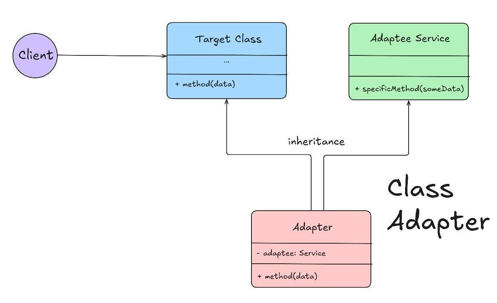

1. PaymentProcessor defines the interface expected by our application.
2. LegacyPayment has an incompatible method called makePayment().
3. PaymentAdapter extends LegacyPayment.
4. It implements PaymentProcessor and delegates pay() to makePayment().

P.S: The adapter inherits the functionality directly from LegacyPayment.

