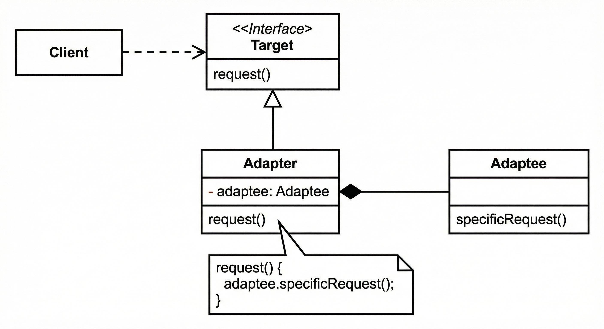

1. PaymentAdapter implements the target interface.
2. Instead of extending LegacyPayment, it maintains an instance of it.
3. When pay() is called, it delegates the operation to legacyPayment.makePayment()

The adapter doesn't inherit the third-party class's functionality. It uses an object of that class.

